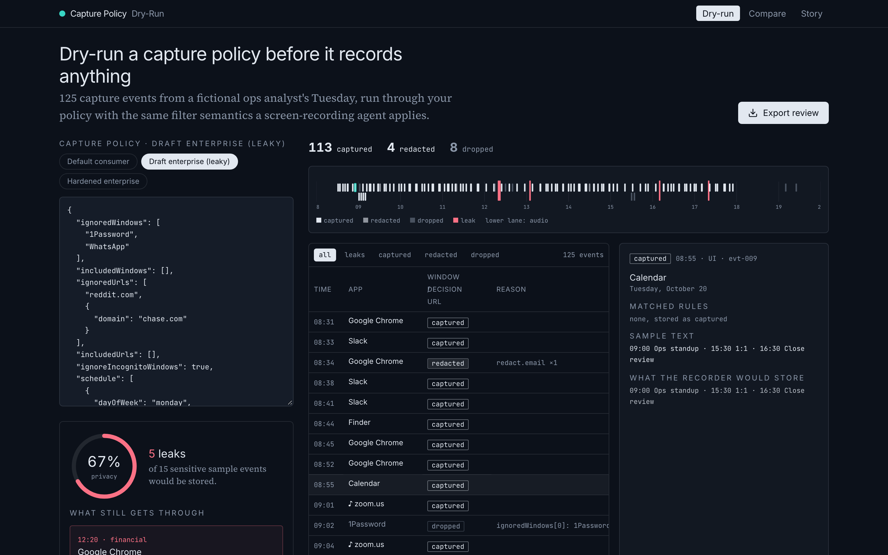
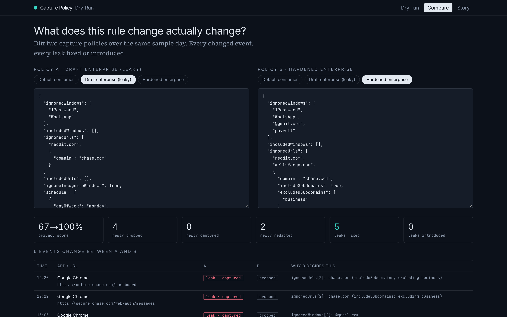
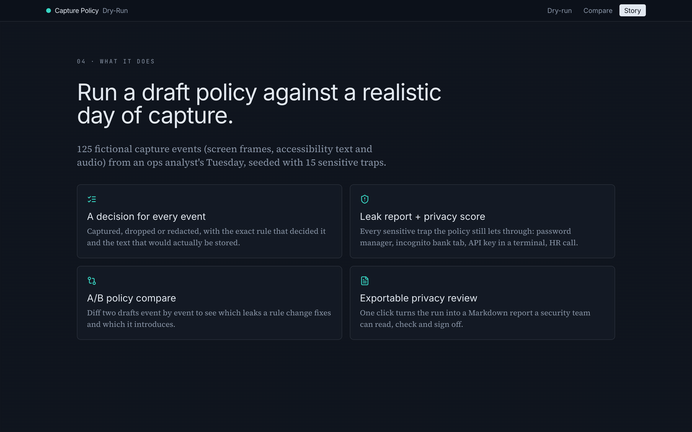
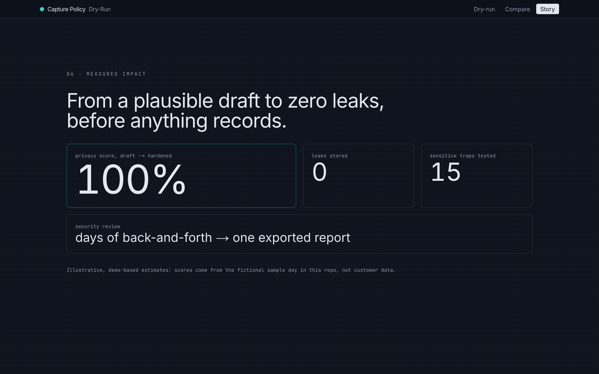

# Capture Policy Dry-Run

**Test a screen-recording privacy policy against a realistic day of capture before it records anything.**

Paste a workspace capture policy (window, URL, incognito, schedule, meeting-app and redaction rules), run it against a
sample day of 125 capture events, and see every decision (captured, dropped or redacted, plus the rule that decided it),
a leak report with a privacy score, an A/B policy diff, and an exportable Markdown privacy review for a security team.

| Dry-run workspace | Compare policies |
|---|---|
|  |  |

| Story: what it does | Story: measured impact |
|---|---|
|  |  |

## The problem

Screen-recording AI tools record what people see, hear and do on their computers, keep it on the device, and hand that
history to AI agents so they can map workflows and automate them. Teams want this, but rollouts stall on one question:
*what exactly will this record on our employees' machines?*

Capture policies (app, window and URL filters, incognito skipping, PII redaction) are meant to be the answer, but there
is no way to test one before it is deployed. Users of popular tools in this space publicly report rules that do not hold:

- incognito windows recorded despite the "skip incognito" setting
- window filters bypassed under remote desktop / VDI focus changes
- no way to pre-exclude an app the recorder has not seen yet, so a policy can only be written after the leak
- developers describing how "even local-only storage triggers a brutal compliance conversation" for teams

## The feature, and why this one

A **capture policy dry-run** turns the policy from a promise into evidence. Whoever deploys the tool (an IT admin, a
security reviewer, a deployment engineer) can iterate on a draft policy against realistic traps: a password manager, an
incognito bank tab, personal banking on a `chase.com` subdomain next to the company's `business.chase.com`, personal
Gmail on the same host as work mail, an API key in a terminal, an HR 1:1 on Teams, a payroll VM over RDP, after-hours
browsing. Then they hand security a report they can verify.

**Alternative considered:** a silent capture-gap detector (flagging hours where recording stopped while health checks
said OK). It lost because gaps are native capture-engine bugs that a web tool could only visualize, while the dry-run
answers the question that blocks team rollouts and is fully verifiable with tests.

### What it does

- **Per-event decisions**: every event is captured, dropped or redacted, with the exact rule (`ignoredUrls[2]: chase.com (includeSubdomains)`) and the text that would actually be stored.
- **Leak report + privacy score**: every sensitive event the policy would still store, scored as `1 - leaks / sensitiveEvents`.
- **A/B compare** (`/compare`): diff two policies event by event, counting leaks fixed and leaks introduced.
- **Export review**: a Markdown privacy review report for the security team.
- **Story** (`/story`): an animated explainer of the problem, the decision and the measured impact.

### Measured impact (computed by the engine on the sample day)

| Preset | Privacy score | Leaks stored |
|---|---|---|
| Default consumer | 27% | 11 |
| Draft enterprise (leaky) | 67% | 5 |
| Hardened enterprise | 100% | 0 |

## Run it

```bash
bun install && bun run dev     # or: npm install && npm run dev
```

- http://localhost:3000: dry-run workspace
- http://localhost:3000/compare: A/B policy diff
- http://localhost:3000/story: animated explainer (respects `prefers-reduced-motion`)

```bash
bun run test        # vitest: 90 tests
bun run typecheck   # tsc --noEmit
bun run build       # next build
```

No secrets, no network calls at runtime. `.env.example` is intentionally empty.

## Policy rules

The engine (`src/lib/policy/evaluate.ts`) implements these fields:

| Field | Semantics in the dry-run |
|---|---|
| `ignoredWindows` | Case-insensitive substring match on `app_name` or `window_name` → dropped (screen events only) |
| `includedWindows` | When non-empty, screen events matching none → dropped |
| `ignoredUrls` | A legacy string matches the domain and all subdomains. A structured `{domain, includeSubdomains, excludedSubdomains}` always matches the exact domain, matches descendants only with `includeSubdomains`, and never matches descendants rooted at an `excludedSubdomains` entry (multi-level entries like `eu.business` work) |
| `includedUrls` | Strict browser allowlist: browser events with no detected URL, or a non-matching one, → dropped. Non-browser apps unaffected |
| `ignoreIncognitoWindows` | Events flagged `incognito: true` → dropped |
| `schedule[]` | `{dayOfWeek, startTime, endTime}`, start inclusive, end exclusive. Empty means always on |
| `ignoredMeetingApps` | Audio events whose `app_name` matches → dropped |
| `redact.categories` | `api_key`, `email`, `credit_card` (Luhn-checked), `password_field` (a11y `AXSecureTextField`), `phone`, `financial_amount` → `[REDACTED:<category>]` with spans |
| Fail closed | A structured URL rule with an empty domain is a validation error and the engine drops **all** browser events rather than guessing |

Hosts are normalized (lowercase, no scheme, port, path, trailing dot or leading `www.`).

A **leak** is a sensitive fixture event that is stored: either captured, or redacted while its `sensitive_text` is still
present. **Privacy score** = `1 - leaks / sensitiveEvents`.

### Wiring it to a real recorder

Events come through a `CaptureSource` interface (`src/lib/source/types.ts`). `FixtureCaptureSource` serves the sample
day. `LocalApiCaptureSource` is a documented stub showing how a local capture API (`GET $CAPTURE_API_URL/search?content_type=all&start_time=…`)
maps onto `CaptureEvent`. It throws `NotConfigured` and is never called by the demo.

## Stack

Next.js 15 (App Router), React 18.3, TypeScript, Tailwind CSS (+ `tailwind-merge`,
`clsx`, `tailwindcss-animate`), framer-motion 11, zod 3, zustand, lucide-react. Tests use vitest, Testing Library and
jsdom. Design: deep slate with one cyan accent (rose for leaks only), Inter, Source Serif 4 and JetBrains Mono.

```
src/lib/policy/   schema.ts url.ts evaluate.ts redact.ts leaks.ts diff.ts report.ts presets.ts
src/lib/source/   types.ts fixture.ts local-api.ts (stub)
src/components/   PolicyEditor EventTimeline EventTable EventDetail LeakReport DiffSummary story/*
fixtures/         sample-day.ts (125 fictional events)
tests/            url evaluate schema redact leaks diff report presets ui
```

## Tests

Written test-first. Unit tests cover every rule type and the edge cases (uppercase hosts, `www.`, trailing dots, ports,
multi-level `excludedSubdomains`, empty `includedWindows`, the 18:00 schedule bound, fail-closed rules), each redaction
detector including a `$` in code false-positive guard, leak scoring, diff counters and a Markdown report snapshot. The
preset contract asserts hardened = 100% / 0 leaks, leaky ≤ 70%, and that the default consumer preset drops no
non-sensitive work event. Component tests cover zod errors on bad JSON, preset switching, rule display, the export
Blob, the compare page and the story page.

## Limitations

- Regex detectors stand in for an on-device PII model.
- The sample day is fictional ("Northstar Operations"). All names, emails, keys and amounts are made up.
- Impact numbers on `/story` are illustrative, computed from that fixture.

---

Built with [Claude Code](https://claude.com/claude-code).
